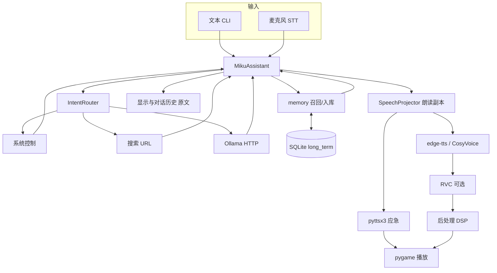

# Miku Assistant LLM

Windows 本地桌面助手：**Ollama 对话**、**长期记忆**、**语音双工**、**本地 Paraformer STT（默认）**、**Edge-TTS / 可选 CosyVoice + RVC 音色**、**受策略约束的系统控制与搜索**。面向中文场景；**TTS 默认仍走 edge-tts 云端**，STT 默认在资产就绪后为本地 CPU，并非开箱即全离线产品。

---

## 定位与当前状态

- **平台**：Windows 10 / 11；主程序 **Python 3.12**，入口 `main.py` → `src/cli/app.py`。
- **形态**：CLI 三种模式 `text` / `voice` / `interactive`；按启动模式懒加载语音栈。纯 **`text`** 模式固定 `use_tts=False`；**`--auto-tts` 不作用于 `text` 模式**（主要影响 `interactive`）。
- **交付与验收**：近期语音链路与资源里程碑见 [`docs/codex-review-final-voice-soak-milestone-2026-11-05.md`](docs/codex-review-final-voice-soak-milestone-2026-11-05.md)、[`docs/current-delivery-status-2026-11-04.md`](docs/current-delivery-status-2026-11-04.md)。**具体指标与适用范围见下文「已验证范围（语音长测）」**；此前失败/取消 run 仍有效，不代表所有模式在所有硬件上已通过。
- **未实现 / 预留**：Quest 3 / Unity / Live2D / 3D 引擎；`src/extensions/character_interface.py` 仅为占位日志；**声学 AEC** 未实现；`wake_word` 仅为配置字符串，**不是**独立唤醒词服务。

---

## 功能与技术栈（已实现）

| 板块 | 能力摘要 | 主要技术 / 入口 |
|------|----------|-----------------|
| **CLI 与会话** | `text` / `voice` / `interactive`；interactive 支持 `help` / `voice` / `tts` / `stream` / `quit` | `main.py`，`src/cli/` |
| **LLM** | HTTP `requests` → Ollama `/api/chat`（JSON / NDJSON 流）；进程内**短历史**（默认最多 **500** 完整轮）与**单次请求窗口**分离；`keep_alive` 默认 **30m** | `src/llm/`，`ollama.history.max_stored_turns` |
| **长期记忆** | 跨重启：**SQLite** 中有界事实；**进程内**另有对话短历史（见上），**二者不同**。用户原文 → `UserFactUnit` → 模型选 `unit_id` → **异步**后台入库（**不一定立刻写入**）；生成前**词法召回**注入；**不保证**每句聊天都进库、**非**全量对话归档 | **`sqlite3` + 事务 + `threading.RLock`**，`src/memory/`；队列 **32** / 每轮最多提取 **16** |
| **记忆保留** | 启用保留时，约每 **24h** 在**空闲且无前台请求**时尝试 prune（`batch_limit` **64**）；目标 **2000** 条 / **365** 天 | **维护目标**，非硬上限；热路径不 VACUUM |
| **意图路由** | 系统控制 → 搜索 → LLM；系统/搜索回复 **`allow_tts=True`**，在 **`use_tts` / `auto_tts` 开启**时可朗读结果（非 LLM 专用） | `src/core/dispatch_outcome.py`，路由 handler |
| **搜索** | 正则 + `urllib.parse` 构造 Google/Bing/Baidu/B 站 URL；`browser_launch` 默认 **false**（可只打印 URL） | `src/search/`；**非**爬虫/API 全文/RAG |
| **系统控制** | 关机/重启/锁屏；Win32 + **确认对话框**；`system.windows_control_enabled` 与 `security.permissions.system_power` 默认 **false** | `src/system/`，`src/core/safety.py` |
| **STT 默认** | **Paraformer-zh + FunASR** 于 **`.venv-asr`**（CPU torch，与主程序/RVC/Cosy **分离**）；**SpeechRecognition + PyAudio** 仍负责麦克风采集；`local_asr_worker: true` + 封存 profile；**无** Paraformer→Google 自动回退 | `src/voice/stt.py`，`scripts/prepare_paraformer.py`，`diagnose_asr.py` |
| **STT 遗留** | **`speech_recognition` + Google** 仍可用：须 `voice.stt.engine: speech_recognition` **且** `cloud_stt: true`（会上传音频） | 显式配置 |
| **STT 可选** | **Whisper**（如 `base`，主进程内加载）；**未**在 `requirements.txt` 中；首次可能联网，需额外 **torch/模型内存** | 可选路径 |
| **TTS 默认** | **edge-tts**（`cloud_tts: true` 发送朗读文本）；句级 rate/pitch/volume；长回复 **分句流水线** | `src/voice/tts/engine.py` |
| **TTS 应急** | **pyttsx3**（**不经 RVC**） | `requirements-optional.txt` |
| **TTS 可选 Cosy** | CosyVoice 300M-Instruct 自有 worker（stdin/stdout JSON 行）；固定 **warm_companion**；**需 NVIDIA CUDA**（无 CUDA 拒绝，无 CPU 回退）；CPU 权重 **checkpoint 分阶段加载 + mmap**（worker 内，见 `checkpoint_loading.py`） | [`assets.py`](src/voice/cosyvoice/assets.py) 等 |
| **RVC** | Nahida；**`.venv-rvc`** worker + 可选单次 infer；**CPU 线程预算**注入子进程/Torch（`cpu_budget.py`） | rvc-python / PyTorch / fairseq / HuBERT / RMVPE / FAISS |
| **音频 DSP** | librosa / NumPy / SciPy / soundfile；RVC 后处理高通 + 软限幅 | `src/voice/rvc/postprocess.py` 等 |
| **播放** | **pygame** 优先 | `src/voice/audio/player.py` |
| **双工语音** | 全双工连续采集（显式 begin，`capture_mode: continuous`）；转写门控用采集区间 vs 回复活动窗（非播放 PCM/AEC）；有效插话取消 | `src/cli/voice_session.py`，`assistant.duplex_*`，[`docs/VOICE.md`](docs/VOICE.md) |
| **自然陪伴** | **warm_balanced** 人格（`src/core/companion.py`）；朗读前 **SpeechProjector**（`src/voice/speech_projection.py`）净化副本；界面与历史保留原文 | 见 `src/core/companion.py` |
| **日志** | 文件约 **10 MiB** ×（1+**5** 备份）≈ **60 MiB** 量级；`logging.handlers.RotatingFileHandler` + **`PrivacyRotatingFileHandler` 脱敏** | `src/core/logging_setup.py` |
| **资源与生命周期** | RAM/commit/VRAM 准入、串行预热、有界 turn 预取、**OwnedThreadTask**、Windows **Job**、TFM **IO lease**；与 Cosy **checkpoint staging/mmap**、RVC **CPU 线程预算** 同为已实现的有界资源策略（**不**承诺 universal 加速或省内存） | `resource.profile`：**balanced** 等 |
| **清理** | `FileCleaner`：`os.scandir` 游标；**10 min** 周期、不同步启动全扫；每轮扫 **500** / 删 **100** | `src/core/file_cleaner.py` |
| **安全** | `SafetyPolicy` 具名能力 + 白名单；**`registry_write` 代码层永久禁止**（配置无效） | `config/config.yaml` → `security.permissions` |
| **Ollama 模板** | `modelfile_manager/Modelfile_v1*` … `v2-1` 为 **Ollama 构建模板**，非训练器 | 见下文 Modelfile |
| **诊断脚本** | 见「诊断与测试分类」 | 根目录 `diagnose_*.py` 等 |

**主环境默认不需要 torch / fairseq**（RVC、Cosy、可选 Whisper 各自独立或额外安装）。

---

## 架构（数据流概览）



- **记忆**：生成前从 SQLite **召回**注入上下文；成功轮次后 **有界异步入库**（与 LLM 生成串行协调，**非**任意并行抢 GPU）。
- **系统 / 搜索**：结果回到助手；在 **`use_tts` / `auto_tts` 允许**时可 TTS（`from_legacy_handler_text` → `allow_tts=True`）。
- **Edge / Cosy** 可接可选 **RVC + DSP**；**pyttsx3** **不经** RVC。朗读副本与屏幕/进程内短历史分离。

---

## 运行环境与依赖

| 环境 | Python | 用途 | 依赖 |
|------|--------|------|------|
| **主程序** | **3.12**（推荐 `.venv-main`） | CLI、Ollama、Edge、记忆、路由、**Paraformer 编排**（worker 在 `.venv-asr`） | [`requirements.txt`](requirements.txt)（版本下界，非 lock） |
| **ASR** | **3.12** `.venv-asr` | FunASR Paraformer-zh CPU worker | [`requirements-asr.txt`](requirements-asr.txt) + [`scripts/prepare_paraformer.py`](scripts/prepare_paraformer.py) |
| **RVC** | **3.11** `.venv-rvc` | rvc-python、PyTorch、fairseq、HuBERT、RMVPE、FAISS | [`scripts/setup_voice_env.ps1`](scripts/setup_voice_env.ps1)（联网安装，未锁全版本） |
| **CosyVoice** | **3.11** `vendor/CosyVoice/.venv` | PyTorch、torchaudio、ModelScope、WeText、Matcha-TTS、ONNX 等 | 与主环境**勿混装**；路径见 `assets.py` |

主环境 `requirements.txt` 摘录：`pyyaml>=6.0.1`，`requests>=2.31.0`，`edge-tts>=6.1.0`，`librosa>=0.10.0`，`soundfile>=0.12.0`，`numpy>=1.24.0`，`scipy>=1.11.0`，`SpeechRecognition>=3.10.0`，`pyaudio>=0.2.14`，`pygame>=2.5.0`。

**外部**：本机 **Ollama**（`http://localhost:11434`）。**TTS 默认**需网络（edge-tts）；**STT 默认**在准备 `.venv-asr` 与 pin 资产后为本地 CPU（运行时不上传识别音频到 Google）。

---

## 本地 Paraformer ASR 准备（默认 STT）

使用 **主程序 Python 3.12**（勿用 `.venv-rvc` / Cosy `.venv` 跑准备脚本）。下文 **`$PY`** 必须是 **带引号的 `python.exe` 路径**（单个可执行文件，不是「启动器 + 参数」）。**禁止** `$PY = py -3.12`：在 PowerShell 里这会**执行**启动器并可能进入交互式 Python，且不能作为 `& $PY script.py` 的解释器路径。若你更习惯 Windows 启动器，请在每条命令上直接写前缀 **`py -3.12 script\...`**，**不要**把 `py -3.12` 赋给 `$PY`。

```powershell
Set-Location D:\Miku_Assistant_LLM
$PY = "$env:LOCALAPPDATA\Programs\Python\Python312\python.exe"
# 若本机已有 .venv-main 且依赖齐全，可改为（路径按你的克隆目录调整）：
# $PY = "D:\Miku_Assistant_LLM\.venv-main\Scripts\python.exe"
& $PY scripts\prepare_paraformer.py --check
& $PY scripts\prepare_paraformer.py --execute
```

- **`--execute`** 会创建/更新 **`.venv-asr`**、安装 `requirements-asr.txt` 并下载**固定 pin** 的 `vendor/paraformer-zh` 资产（**一次性显式**；运行中无云回退/无隐式下载）。
- 准备完成后 **重启助手**，以便装配期 `SafetyPolicy` 重新封存 ASR profile。
- 诊断（固定 WAV，无麦克风）：`& $PY diagnose_asr.py`（dry-run）；真实 CPU 验收 `& $PY diagnose_asr.py --execute`（Codex 监督门禁，非 unittest）。

**准入（冷启动 headroom，非整机总 RAM 保证）**：可用物理内存 **≥ 4 GiB**、可用系统 commit **≥ 6 GiB**（与 RVC/Cosy 阈值独立）。本机 Codex 固定音频里程碑参考：冷首次推理约 **12 s**；热 p50≈**0.34 s**、p95≈**0.67 s**（仅推理，不含录音停顿/LLM/TTS/RVC）。低配与其它硬件不保证相同延迟或准确率。

**CPU 线程**：`voice.stt.paraformer.cpu_threads` 有效 **1–4**，默认 **2**。本阶段无流式/VAD/热词/标点模型/说话人模型。

**声学准入（Phase 2a 默认 Silero）**：`voice.stt.input_audio.backend` 默认 **`silero_onnx`**（概率门限默认 0.6）；`webrtc` 为显式兼容。固定模型 `vendor/silero-vad/silero_vad.onnx`（校验见 `docs/VOICE.md`），**不**运行期下载。主 `requirements.txt` 通过 `-r requirements-input-audio.txt` 引入 CPU onnxruntime/numpy pin。`python main.py` 启动前会设置 BLAS/OMP 四键为 1（`src/core/numeric_bootstrap.py`）。PCM 硬边界 480000 字节不变。WebRTC 路径仍依赖 **`webrtcvad-wheels==2.0.14.post1`**。未声称已完成真实麦克风复测。

**回退 Google STT**：在 `config/config.yaml` 设置 `voice.stt.engine: speech_recognition` 且 `security.permissions.cloud_stt: true`（会上传麦克风音频）。

**麦克风验收（真实 voice 模式，勿在 PowerShell 提示符里当自然语言输入）**：

1. 完成 ASR 准备并重启后：`& $PY main.py --mode voice`（`$PY` 为上一节设置的 `python.exe` 路径）
2. 对麦克风说 2–3 句代表性中文（含短问句与稍长陈述），确认助手能收到转写并回复。
3. 退出 voice 再进入一次，确认重启后记忆/会话行为仍符合预期（**不**声称已通过 30 min 全栈 soak 或声卡 A/B 门禁）。

纯 **`text`** 模式仍 **不** 构造 STT，无 ASR 资产也可启动。

---

## 本地快速启动

在 **PowerShell** 中进入你的克隆目录（**示例**，请改成实际路径）：

```powershell
Set-Location D:\Miku_Assistant_LLM
```

**主程序 Python 3.12**（勿用 `.venv-rvc` 或 `vendor/CosyVoice/.venv` 运行 `main.py`）：

- **已有**主环境（例如本机已配置好的 3.12 venv 或全局 `py -3.12`）：可直接用其 `python.exe`，**不必**重建。
- **新建**隔离环境时（尚无 `.venv-main`）：

```powershell
py -3.12 -m venv .venv-main
.\.venv-main\Scripts\python.exe -m pip install -r requirements.txt
```

若 `.venv-main` 已存在且依赖齐全，**跳过** `pip install`。

**Ollama**（当前终端只做检查，**不要**在这里长期前台运行 `ollama serve`）：

```powershell
ollama list
```

| 情况 | 处理 |
|------|------|
| **`ollama list` 连接失败** | 在**另一个终端**启动 `ollama serve`，再回到本终端重试 `ollama list` |
| **能连上但列表为空** | 需自行 `pull` / `ollama create` 准备模型；**再开一个 `serve` 不会自动出现模型** |

`ollama list` 只说明**本机已安装**哪些模型名。助手**实际调用**哪一个是 [`config/config.yaml`](config/config.yaml) 的 **`ollama.model`**，启动成功时也会在日志中打印；请把该键设为列表里**存在**的名称（默认可为 `Miku_Assistant-emotion:latest`，须你已安装）。

**可选 RVC 权重**：`src/voice/Nahida/`（不入库）。需要时再阅读 [`scripts/setup_voice_env.ps1`](scripts/setup_voice_env.ps1)。

启动（示例使用 `.venv-main`；若你用其它 3.12 解释器，替换为同一路径）：

```powershell
.\.venv-main\Scripts\python.exe main.py
```

---

## 运行模式与命令

以下示例均使用 **`.\.venv-main\Scripts\python.exe`**（请换成你实际的主程序 3.12 解释器路径）：

| 命令 | 说明 |
|------|------|
| `.\.venv-main\Scripts\python.exe main.py` | 默认 **interactive** |
| `.\.venv-main\Scripts\python.exe main.py --mode text` | 纯文本，**不朗读** |
| `.\.venv-main\Scripts\python.exe main.py --mode voice` | 语音会话 |
| `.\.venv-main\Scripts\python.exe main.py --mode interactive` | 文本 + 可切语音/TTS/stream |
| `.\.venv-main\Scripts\python.exe main.py --config 路径\config.yaml` | 指定 YAML |
| `.\.venv-main\Scripts\python.exe main.py --stream` | 增量显示 / 分句播报 |
| `.\.venv-main\Scripts\python.exe main.py --auto-tts` | 打开 `assistant.auto_tts`（**不改变** `text` 模式不 TTS） |

**interactive 常用输入**：`help` · `voice` / `开启语音模式` · `tts` · `stream` · `quit` / `exit` / `退出`。

语音预检：麦克风、Ollama、模型存在。双工见 [`docs/architecture/adr-duplex-listening.md`](docs/architecture/adr-duplex-listening.md)、[`docs/VOICE.md`](docs/VOICE.md)。

---

## 可选 RVC 与 CosyVoice

修改配置时**只合并下列键到现有 `config/config.yaml`**，**不要**用整段示例覆盖整个文件。

### RVC（Nahida）

- 节点：`voice.tts.rvc.*`（`model_path`、worker、`index_rate`、`protect`、`rms_mix_rate`、`f0_method` 等）。
- **`protect`**：**0.0–0.5**；**0.5 = 关闭保护**，更小更保护清辅音。
- **`filter_radius`**：仅 **`f0_method=harvest`** 有效；默认 **`rmvpe`** 时不生效。
- 仓库 YAML 示例：`pitch: 0`，`index_rate: 0.55`，`protect: 0.5`，`rms_mix_rate: 0.68`，`filter_radius: 1`，`f0_method: rmvpe`（调参不保证消除电流音）。
- 可能加载真实设备：`diagnose_rvc.py`、`test_rvc_conversion.py`。

### CosyVoice（本地）

须同时设置：

```yaml
voice:
  tts:
    engine: cosyvoice

security:
  permissions:
    local_tts_worker: true
```

**硬件**：生产 worker 准入要求 **NVIDIA CUDA 可用**（`src/voice/cosyvoice/worker_admission.py`；无 CUDA 返回 `cuda_unavailable`，**无** CPU 回退）。

**固定路径**（相对仓库根，详见 [`src/voice/cosyvoice/assets.py`](src/voice/cosyvoice/assets.py)）：

| 用途 | 相对路径 |
|------|----------|
| Worker 解释器 | `vendor/CosyVoice/.venv/Scripts/python.exe` |
| 模型目录 | `vendor/CosyVoice/pretrained_models/CosyVoice-300M-Instruct` |
| WeText | `vendor/CosyVoice/pretrained_models/wetext` |
| Matcha-TTS | `vendor/CosyVoice/third_party/Matcha-TTS` |
| Runtime worker 脚本 | `scripts/cosyvoice_runtime_worker.py` |

须在上述 venv 与 pin 资产就绪后启用；仓库**不提供**一条命令完成 Cosy 全量部署。

---

## Ollama Modelfile 模板

[`modelfile_manager/`](modelfile_manager/) 含 `Modelfile_v1` … `v1-3`、`Modelfile_v2-1`：

| 模板 | `FROM` 基座（模板内声明） |
|------|---------------------------|
| **v1 系列** | `gemma3:12b` |
| **v2-1** | 已有 **`Miku_Assistant:latest`** |

模板用于人工 `ollama create` 迭代参数/人格（**不是**训练器）。**`ollama list` 仅列出已安装模型名**；助手选用哪一个由 **`config` 的 `ollama.model`** 决定，启动日志也会显示当前模型。Modelfile 里的 `FROM` 只说明 create 时需要哪些**已有**基座（例如 v1 需 `gemma3:12b`，v2-1 需 `Miku_Assistant:latest`），**不能单凭模板推断**你机器上正在跑的名字。

---

## 关键配置、隐私与权限

主文件：[`config/config.yaml`](config/config.yaml)。

| 主题 | 默认值 / 要点 |
|------|----------------|
| **记忆** | `memory.enabled: true`；`db_path: data/memory/long_term.sqlite3`；召回 8 / 1200 字 / 200 候选。**进程内短历史**见 `ollama.history.max_stored_turns`（默认 500），与 SQLite **长期事实**分开 |
| **资源 / Ollama 驻留** | **`resource.ollama.unload_on_exit: false`（默认）**：退出时**不**主动 unload；配合 **`ollama.keep_alive: 30m`**，应用关闭后模型**可能仍**留在共享 Ollama 中。**`true`**：退出时对配置模型 **best-effort** 发送 `keep_alive=0`（**可能失败**或被其它客户端再次加载）；**不**停止 `ollama serve` 进程。两种设置与运行期 `keep_alive: 30m` 的请求语义并存，**并非**“30m 一定压过成功的 unload” |
| **resource.profile** | 默认 **balanced**（另有 low_vram / aggressive_keepalive） |
| **日志** | `assistant.logging.*`；`include_tracebacks: false` |
| **清理** | `data/tmp` 1h、`logs/` 1d、`data/test` 72h；不递归全仓、不默认清根 `tmp/` 与 vendor 缓存 |

`security.permissions` 摘录：

- **false（默认）**：`registry_read`、`system_power`、`subprocess`、`os_shell`、`browser_launch`、`remote_model_endpoint`、**`insecure_remote_model_http`**、`env_modify`、**`cloud_stt`**、`local_tts_worker`
- **true（默认）**：**`local_asr_worker`**、`cloud_tts`、`rvc_worker`、`rvc_infer`、`rvc_probe`、`file_delete`（白名单目录）
- **`registry_write`**：仅配置占位，**代码永久拒绝**

系统控制：`system.windows_control_enabled: false`，`system.require_confirmation: true`。

应用层策略，**非** OS 级沙箱。

---

## 已验证范围（语音长测）

来源：[`docs/codex-review-final-voice-soak-milestone-2026-11-05.md`](docs/codex-review-final-voice-soak-milestone-2026-11-05.md)（2026-11-05）。

| 项 | 结果（特定机器 / 监督 run，**不可外推**） |
|----|------------------------------------------|
| 链路 | 真实 App 流式 → Ollama 12B → CosyVoice → Nahida RVC → **capture-only**（**无**麦克风/扬声器/正式 memory DB） |
| 调度 | steady **1800s**；前 **28** 分钟 **15s** 节拍启轮，尾 **2** 分钟不启新轮（**非**连续满 30 分钟合成） |
| 轮次/音频 | **112/112** 轮成功；**114** 段 WAV 经帧/采样率校验；最多留存 6 段 capture |
| 延迟 | 首可播放就绪中位 **~6094ms**，P95 **~7188ms**（非声卡出声延迟） |
| 资源 | 受控进程树 RSS 峰值 **~10448MiB（≈10.2GiB）**；约 **63GiB RAM / 16GiB GPU** 主机 |
| 退出 | 父/子 exit 0；App/Timer/TFM/warmup/guard 等 quiet；`speech_errors=[]` |

**122 + 18** 等为**特定离线门禁**计数，不是全仓 `unittest discover` 的默认预期。其它模式、低配硬件与长期泄漏需单独验证。

---

## 数据目录

| 路径 | 内容 |
|------|------|
| `data/memory/long_term.sqlite3` | 正式长期记忆 |
| `data/tmp/` | 主程序登记的部分临时音频 |
| `data/test/` | 测试/自然度输出 |
| `logs/miku.log` | 运行日志 |
| `tmp/` | 开发/诊断临时（默认定时清理**不**覆盖） |

---

## 诊断与测试分类

| 脚本 | 说明 |
|------|------|
| `diagnose_memory.py` | 默认 dry-run；`execute` 才连 Ollama 且用测试库 |
| `diagnose_memory_ids.py` | 默认只读；删库需显式确认计划 |
| `diagnose_resource_soak.py` | 离线 fake |
| `diagnose_rvc.py` / `test_rvc_conversion.py` | 可能加载真实 RVC/设备 |
| `diagnose_expressive_tts.py` / `diagnose_rvc_artifacts.py` | 可能加载真实 TTS/RVC |

单元测试在 `tests/`（unittest + mock）。仓库内 `tmp/` 诊断监督脚本供维护者门禁使用，**不是**新用户必需步骤。

开发入口：[`AGENTS.md`](AGENTS.md)、[`docs/engineering-baseline.md`](docs/engineering-baseline.md)、[`docs/architecture/`](docs/architecture/)、[`docs/VOICE.md`](docs/VOICE.md)。

---

## 项目结构（精简）

```text
Miku_Assistant_LLM/
├── main.py
├── config/config.yaml
├── requirements.txt
├── modelfile_manager/
├── src/
│   ├── cli/
│   ├── core/          # assistant、companion、路由、safety、logging_setup
│   ├── llm/
│   ├── memory/
│   ├── search/ / system/
│   └── voice/         # stt、speech_projection、tts、rvc、cosyvoice
├── scripts/
├── vendor/CosyVoice/
├── docs/
├── data/
└── tests/
```

---

## 故障排查（简表）

| 现象 | 建议 |
|------|------|
| Ollama 失败 | 另开终端 `ollama serve`；核对 `base_url`、`ollama list`、`ollama.model` |
| 模型不存在 | 改为已有模型名；Modelfile create 前确认 `FROM` 基座 |
| 语音模式失败 | 默认 STT：**`.venv-asr`** + `vendor/paraformer-zh` pin 资产（`prepare_paraformer.py --check`）、`local_asr_worker: true`、准备后**重启**以封存 profile、内存准入（可用物理 **≥4 GiB** / commit **≥6 GiB**）、麦克风/PyAudio；**仅**显式 `engine: speech_recognition` 且 `cloud_stt: true` 时需 Google 与外网 |
| 默认音色非 RVC | `.venv-rvc` 与 Nahida 路径；`diagnose_rvc.py` |
| Cosy 无法启动 | CUDA 与 `assets.py` 路径、venv、`local_tts_worker` |
| 耗时 | 日志 `[Ollama计时]`、`[TTS计时]` |

测试：`MIKU_DRY_RUN=1` 禁用电源/子进程等（见 `src/core/safety.py`）。

---

## 第三方组件

- [Ollama](https://ollama.com/)、[edge-tts](https://github.com/rany2/edge-tts)、[FunASR](https://github.com/modelscope/FunASR)、[Paraformer-zh（Hugging Face，仓库 pin  revision）](https://huggingface.co/funasr/paraformer-zh)、[rvc-python](https://github.com/JarodMica/rvc-python)、[SpeechRecognition](https://github.com/Uberi/speech_recognition)、[pygame](https://www.pygame.org/) 及 Cosy/vendor 栈等。

各组件遵循**其自身**许可；使用 RVC 权重与上游模型前请单独确认授权。

---

## 许可证

仓库根目录**没有** `LICENSE` 文件：**本项目源代码的授权方式尚未在仓库中明确声明**。第三方组件的许可**不**自动等于本项目可用或再分发权限；使用前请自行核实。

---

## 已知边界

- 默认云端 TTS（edge-tts）；Whisper/Cosy 为可选重路径；**STT 默认本地 Paraformer**（须准备 `.venv-asr`）。
- 记忆为有界启发式；**异步入库**与 **SQLite 长期事实** 不保证完整对话归档。
- 双工插话为转写级门控；麦克风声学准入（NS/Silero guard）在 STT recognize 路径，与双工回声过滤分离；无声学 AEC。
- `resource.profile` 不自动适配硬件；Ollama 驻留受 `keep_alive` 与 `resource.ollama.unload_on_exit` 影响。
- 文件清理有界，不覆盖全仓与 vendor 缓存。

*文档与 2026-11-05 代码及 `config/config.yaml` 核对；历史 ADR 中已撤回实验不视为现行功能。*
